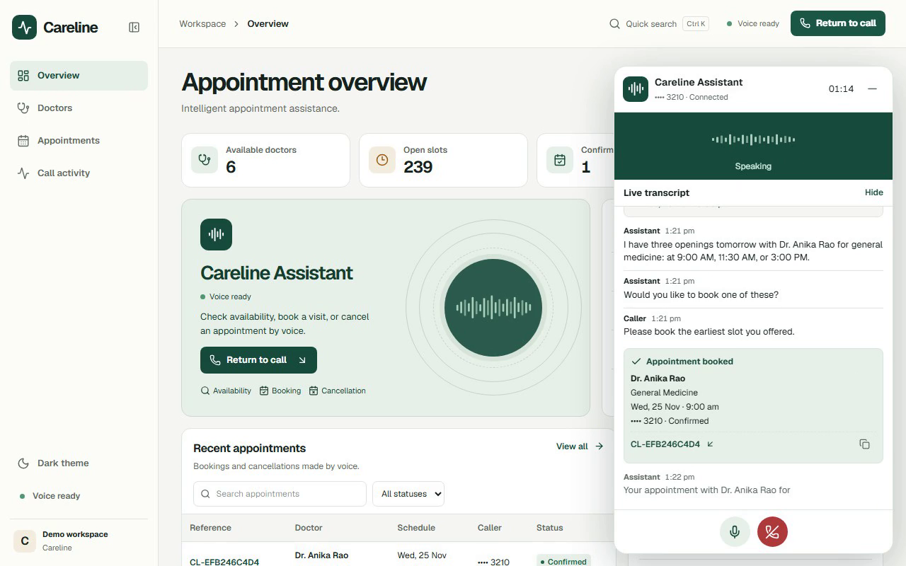
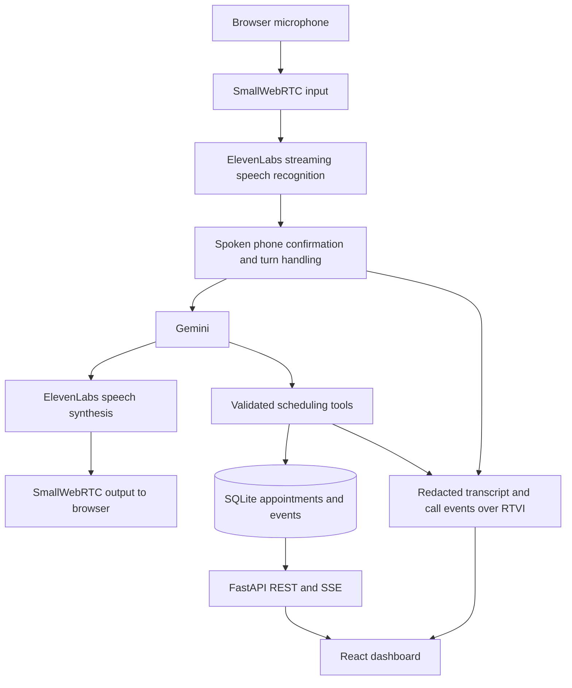

# Careline

Careline is a browser-based voice scheduling assistant for a fictional clinic. A caller can ask about availability, book an appointment, and cancel it in the same conversation. The dashboard shows the live transcript, the actions Gemini takes, and appointment changes as they commit.

[Watch the 1:39 demo](docs/demo-recording.mp4) | [Run locally](#run-locally) | [Architecture](#architecture) | [Testing](#testing) | [Interview guide](docs/interview.md)



The recording uses synthetic caller speech and the live ElevenLabs and Gemini services. It shows spoken phone confirmation, a General Medicine availability search, a booking appearing on the dashboard, and cancellation in the same call. The cancellation was also verified against SQLite to confirm the slot reopened.

## What you can do

| Workspace | What it shows |
| --- | --- |
| **Overview** | Available doctors, open slots, confirmed and cancelled appointments, the clinic schedule, and recent activity |
| **Doctors** | Fictional doctors by specialty, with available and booked slots |
| **Appointments** | A searchable appointment list, a weekly calendar, and appointment details with masked caller information |
| **Call activity** | Session duration and outcome, recorded actions, and redacted transcripts |
| **Try Call** | A browser voice call with mute, minimize, a waveform driven by audio levels, live transcripts, and appointment confirmation cards |

[Overview](docs/screenshots/dashboard.png) | [Doctor directory](docs/screenshots/doctors.png) | [Calendar](docs/screenshots/calendar.png) | [Dark mode](docs/screenshots/dark.png) | [Mobile](docs/screenshots/mobile.png) | [Live call summary](docs/screenshots/live-summary.png)

## Run locally

Install Git, Python 3.12 or 3.13, uv, Node.js 24, and npm. Use a browser with microphone access. Voice calls require an ElevenLabs API key, a voice available to that account for API synthesis, and a Gemini API key.

### 1. Clone and configure

```sh
git clone https://github.com/PATHAN-0716/careline.git
cd careline
```

Copy `.env.example` to `.env` at the repository root. Use `Copy-Item .env.example .env` in PowerShell or `cp .env.example .env` in Bash. Fill in the three voice settings in `.env`. The tracked example contains placeholders and defaults.

| Variable | Required for voice | Purpose |
| --- | --- | --- |
| `ELEVENLABS_API_KEY` | Yes | Authenticates streaming speech recognition and synthesis |
| `ELEVENLABS_VOICE_ID` | Yes | Selects the assistant's synthesis voice |
| `GOOGLE_API_KEY` | Yes | Authenticates Gemini requests |
| `GEMINI_MODEL` | Optional | Defaults to `gemini-3.5-flash-lite` |
| `CARELINE_DB` | Optional | SQLite path. Without an override, the backend uses `careline.sqlite3` at the repository root |
| `CARELINE_ORIGIN` | Optional | Allowed browser origin. Defaults to `http://localhost:5173` |

### 2. Start the backend

From the repository root, open a terminal and run:

```sh
cd backend
uv sync --locked
uv run uvicorn careline.main:app --host 127.0.0.1 --port 8000
```

Startup initializes SQLite and seeds the fictional clinic. The backend serves [Swagger UI](http://127.0.0.1:8000/docs) and a [health endpoint](http://127.0.0.1:8000/api/health).

### 3. Start the frontend

In a second terminal, from the repository root:

```sh
cd frontend
npm ci
npm run dev
```

Open [http://localhost:5173](http://localhost:5173). Vite proxies `/api` requests to the local backend. The dashboard, doctor directory, and seeded schedule are available without provider keys. With the three voice settings present, click **Try Call** and grant microphone permission. Restart the backend after changing `.env`.

### 4. Try a complete call

1. Say “My demo phone number is nine eight seven six five four three two one zero.” Listen to the readback, then say “Yes.”
2. Ask “Do you have openings for General Medicine tomorrow?”
3. Wait for options, then say “Please book the earliest slot you offered.” Look for the booking ticket and the new dashboard row.
4. Say “Please cancel the appointment I just booked.” Confirm the row changes to **Cancelled** and the slot becomes available again.
5. End the call to see the summary. The [demo script](docs/demo.md) has a timed walkthrough and the short pipeline description for the assignment.

## Architecture

| Layer | Implementation |
| --- | --- |
| Workspace | React, TypeScript, Vite, Tailwind CSS, TanStack Query |
| Backend | Python, FastAPI, Pydantic, Uvicorn |
| Voice transport | Pipecat SmallWebRTC for audio and RTVI for call events |
| Speech and turn-taking | ElevenLabs Scribe v2 Realtime, ElevenLabs Flash v2.5, Silero VAD |
| Scheduling decisions | Gemini Flash-Lite with native function calling |
| Persistence and refresh | SQLite, REST queries, server-sent events |



### Scheduling tools

| Tool | Input | Result |
| --- | --- | --- |
| `check_doctor_availability` | Optional doctor name or ID, specialty, or ISO date | Returns available slots with stable slot IDs |
| `book_appointment` | A slot ID returned by availability | Books the selected slot for the verified caller and returns an appointment reference |
| `cancel_appointment` | Optional appointment reference | Cancels a future booking belonging to the verified caller. When several appointments match, the caller chooses one verbally |

Phone confirmation is enforced in the backend. The caller says a number, the assistant reads it back, and the server waits for an explicit affirmative turn after playback completes. A correction restarts confirmation. Gemini's scheduling tools receive the verified caller identity from session state, with appointment and slot arguments validated separately.

Booking checks that the selected slot exists and is in the future. A SQLite transaction and a partial unique index enforce one confirmed appointment per slot, including concurrent attempts. Cancellation preserves the appointment record and removes the confirmed booking's hold on the slot. Both operations record their dashboard events with the state change. The clinic calendar uses `Asia/Kolkata`.

### Browser updates and API

RTVI carries session-specific transcripts and action cards on the call's data channel. The dashboard subscribes to server-sent events and refreshes its REST-backed queries when committed state changes. This lets the booking ticket appear inside the call while counts, slots, and appointment rows update in the workspace.

| Endpoint | Purpose |
| --- | --- |
| `GET /api/health` | Reports whether voice settings are present and returns the clinic date and timezone |
| `POST /api/offer`, `PATCH /api/offer` | Negotiate the SmallWebRTC connection and exchange connection updates |
| `GET /api/doctors` | Returns the clinic directory and schedule |
| `GET /api/appointments` | Lists confirmed and cancelled appointments |
| `GET /api/sessions` | Lists recent calls |
| `GET /api/sessions/{session_id}/events` | Returns redacted events for a call |
| `GET /api/activity` | Returns recent dashboard activity |
| `GET /api/events` | Streams dashboard events over SSE |

## Repository layout

```text
backend/
  careline/main.py              FastAPI app, signaling registration, REST and SSE
  careline/voice.py             Pipecat pipeline, Gemini tools and call handling
  careline/identity.py          Phone normalization, confirmation and redaction
  careline/store.py             SQLite schema, seeded schedule and transactions
  tests/                       Scheduling, confirmation and WebRTC regression tests
frontend/
  src/                         Dashboard, call panel, API and browser voice client
  tests/                       Playwright specs for the workspace and call UI
docs/
  demo-recording.mp4            Recorded live booking and cancellation
  demo.md                      Demo script and short pipeline description
  interview.md                 Architectural choices and trade-offs
  screenshots/                 Workspace and live-call captures
```

## Testing

Run the backend checks from `backend/`:

```sh
uv run pytest
```

The backend suite covers concurrent booking, cancellation and slot restoration, ownership, verbal confirmation, transcript redaction, and a local WebRTC handshake and hangup with provider stubs.

Run the frontend checks from `frontend/`:

```sh
npm run lint
npm run build
npx playwright install chromium
npm test
```

The browser suite uses fixtures for repeatable checks of navigation, responsive layouts, microphone errors, and call UI state. The recorded browser call separately verified the live providers and all three scheduling tools.

## Troubleshooting

| Symptom | Check |
| --- | --- |
| **Setup required** | Confirm the three voice settings are in the root `.env`, then restart the backend. The health endpoint reports configuration presence. |
| **Microphone permission denied** | Enable microphone access for `localhost:5173` in the browser and operating system, then retry. |
| **Call connects without a greeting** | Check that Gemini can generate with the selected model and that your ElevenLabs account can synthesize speech with the configured voice. A premade voice available to your account is a useful check. |
| **Dashboard data fails to load** | Confirm FastAPI is listening on `127.0.0.1:8000` and open the health endpoint directly. |
| **A requested slot is unavailable** | Ask for current availability before trying to book another slot. |

## Demo scope and data handling

Careline is a single-process localhost assessment demo for fictional data. Spoken phone confirmation is a demo identity rule. Deploying outside localhost requires HTTPS for microphone access and may require TURN for WebRTC connectivity.

Keep provider credentials in the Git-ignored `.env`. SQLite stores redacted transcript entries, masked phone suffixes, and keyed phone digests for matching bookings. The app streams audio to the configured speech services and retains no raw audio in the database. Keep the SQLite file and its companion `.key` file together so returning callers can match their previous bookings.
