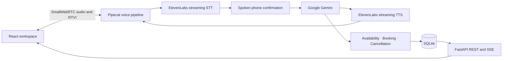

# Careline

Intelligent appointment assistance. Careline is a browser voice scheduling demo for a fictional clinic. Callers can check a doctor’s schedule, book a visit, and cancel it in one conversation. The workspace shows open slots, appointments, the live transcript, and committed actions.

## Run locally

You need Python 3.12 or 3.13, uv, Node 24, and npm. Create a root `.env` from `.env.example` and set these backend variables.

| Variable | Purpose |
| --- | --- |
| `ELEVENLABS_API_KEY` | Access to streaming speech recognition and synthesis |
| `ELEVENLABS_VOICE_ID` | An available ElevenLabs voice |
| `GOOGLE_API_KEY` | Google Gemini API access |
| `GEMINI_MODEL` | Model override. Defaults to `gemini-3.5-flash-lite` |
| `CARELINE_DB` | Optional SQLite path. Defaults to the project root |
| `CARELINE_ORIGIN` | Optional allowed browser origin. Defaults to `http://localhost:5173` |

From the project root, start each service in its own terminal.

```sh
cd backend
uv sync --locked
uv run uvicorn careline.main:app --host 127.0.0.1 --port 8000
```

```sh
cd frontend
npm ci
npm run dev
```

Open [Careline](http://localhost:5173) and allow microphone access when you start a call. The scheduling workspace runs without keys and displays **Setup required** until all three voice settings are present. Use localhost or HTTPS for browser microphone permissions.

## Architecture



Silero handles speech boundaries in the Pipecat user aggregator. Gemini chooses registered functions, and server handlers validate their inputs and confirmed caller identity. SQLite owns appointment state and records successful changes with their dashboard events. The WebRTC data channel carries session-specific actions and redacted transcript updates. SSE prompts the workspace to refresh committed rows, counts, and slots.

## Tests

```sh
cd backend
uv run pytest
```

```sh
cd frontend
npm run lint
npm run build
npx playwright install chromium
npm test
```

Browser tests use fixtures for repeatable UI checks. The live browser test exercised ElevenLabs speech, spoken phone confirmation, Gemini function calls, booking, and cancellation in one session. Follow the [live demo checklist](docs/demo.md) to reproduce it.

## Recorded demo

[Watch the live browser demo](docs/demo-recording.mp4). It uses synthetic caller speech and the live ElevenLabs and Gemini services. The recording shows the appointment appear on the dashboard, followed by the cancellation and call summary.

## Screenshots

[Dashboard](docs/screenshots/dashboard.png) · [Doctors](docs/screenshots/doctors.png) · [Calendar](docs/screenshots/calendar.png) · [Dark theme](docs/screenshots/dark.png) · [Mobile](docs/screenshots/mobile.png)

[Live booking ticket](docs/screenshots/live-booking.png) · [Live post-call summary](docs/screenshots/live-summary.png)

## Demo boundaries

Use fictional callers and doctors. Spoken phone confirmation is a demo identification rule. SQLite retains masked transcript entries, masked phone suffixes, and a keyed phone digest used for matching. It stores no raw audio. The browser sends live audio to the configured providers. Keep the local database and its companion key file together between restarts. Use this workspace for the assessment demo only.

SmallWebRTC is configured for localhost. Remote deployments need HTTPS and may need TURN. The demo uses one FastAPI process and local SQLite. See the [interview guide](docs/interview.md) for the pipeline and trade-offs.
